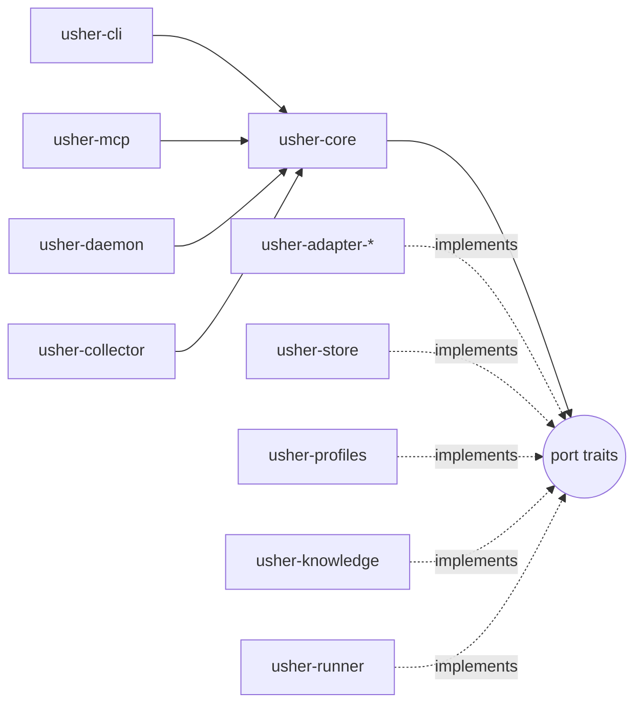
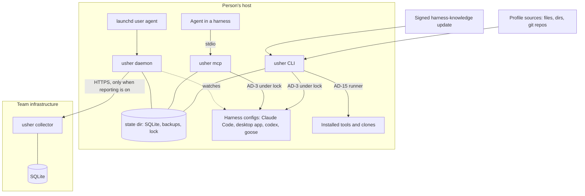

# Architecture Spine: usher

## Design Paradigm

Hexagonal. The core holds the domain: the map of environments, comparisons, proposals,
the change journal and hazard checks. It knows no harness, file format, surface or
transport. Everything outside the core reaches it through a port.

| Layer | Holds | Crate |
| --- | --- | --- |
| Core | map, comparison, proposal, journal rules, hazard rules, report schema, `UsherError` | `usher-core` |
| Driven ports | harness adapters, store, profile sources, harness knowledge, delegated runs | `usher-adapter-*`, `usher-store`, `usher-profiles`, `usher-knowledge`, `usher-runner` |
| Driving adapters | CLI, MCP server, daemon (watcher), light collector | `usher-cli`, `usher-mcp`, `usher-daemon`, `usher-collector` |
| Binary | one `usher` executable selecting a mode | `usher` |
| Tests | scratch-home kit, harness fixtures, invariant checks | `usher-testkit` |



Dependencies point inward. A driving adapter never calls a driven adapter directly, and
no adapter depends on another adapter.

## Invariants & Rules

### AD-1: One binary, four modes, one store

- **Binds:** all
- **Prevents:** separately shipped tools with their own state disagreeing about the map or the journal
- **Rule:** usher ships as one executable. `usher <command>` (CLI), `usher mcp` (stdio MCP
  server), `usher daemon` (watcher) and `usher collector` (light collector) are modes of it.
  Client modes resolve one state directory per OS user from the OS user's account home (not
  `$HOME`, which a harness or sandbox may override), and open one store there (AD-7). No mode
  requires the daemon: bootstrap (FR-46), apply and removal (FR-67) work with no daemon. The v2 app
  (AD-21) is a separate optional bundle that opens this same store and adds no state of its own.

### AD-2: One writer at a time, through the journal lock

- **Binds:** FR-9 to FR-12, FR-44 to FR-52, FR-63, FR-64, FR-67
- **Prevents:** two modes changing harness configuration, installed tools or the journal in different orders
- **Rule:** any change to a harness file, an installed tool, a clone or usher's journal happens
  only while holding the journal lock: `std::fs::File::lock` (flock on macOS, LockFileEx on
  Windows) on one file in the state directory. Confirmation (AD-4) comes first; the
  lock is then taken and held for the whole transaction (AD-3) and released after the outcome is
  recorded. Reads never take it.

### AD-3: Every change is a five-step transaction the person can resume or roll back

- **Binds:** FR-49 to FR-52, FR-63, FR-64, FR-67
- **Prevents:** a write that reaches a harness file without a journal record, and a crash resolved without the person
- **Rule:** under the lock, in order: (1) record the intent, with each target's hash before the
  change; (2) back up what the change touches (AD-7); (3) write through the adapter (AD-5) or
  run the delegated command (AD-15); (4) read back and compare with the intent; (5) record the
  outcome with each target's hash after. Each step's row is committed to disk before the next
  step starts. At apply time each target's hash must still equal the proposal's base hash
  (AD-16); otherwise usher writes nothing and asks for a fresh proposal. An intent with no
  outcome is a crash marker. It is resolved only by an explicit resume or roll back, from the CLI,
  MCP or the app, after each target's state is shown and confirmed (AD-4); the choice is journaled. The
  daemon never resolves one. Until it is resolved, every mode refuses new changes, keeps serving
  reads, and names the command that resolves it. A target whose hash is neither the recorded before nor after is a conflict and is
  left alone.

### AD-4: Every surface confirms the same way, and the journal records which one did [ADOPTED]

- **Binds:** FR-62, PRD §5 confirmation rule, addendum §7
- **Prevents:** surfaces with different confirmation rules, and changes whose origin cannot be traced
- **Rule:** the CLI and MCP modes, and the v2 app (AD-21), may each apply, roll back, resolve a
  crash marker, remove and run delegated commands, under the same steps: show the diff computed per AD-16, take a
  confirmation, then run AD-3. An agent working for the person confirms as the person can
  (operator ruling, 2026-11-08). The journal records the surface that confirmed (`cli`, `mcp`,
  `app`) and, for MCP, the client name the harness reported. The daemon never applies a change.

### AD-5: The harness's own writer first, every other byte unchanged

- **Binds:** FR-49, FR-64, all harness adapters
- **Prevents:** usher and a harness disagreeing about format or validation, and a write that disturbs keys it did not target
- **Rule:** an adapter writes through the harness's native writer where one exists (codex
  app-server `config/value/write`, `config/batchWrite`). Otherwise it edits the file with a
  format-preserving editor (`toml_edit`, `jsonc-parser` with `cst`, `yamlpatch`) and then checks
  that every byte outside the target value is unchanged; a change outside it aborts the write. A
  file edit resolves symlinks to the real path, writes a temporary file in the same directory,
  syncs it to disk and renames it over the target, so a hot-reloading harness never reads a
  partial file. Usher never deletes a harness file. Both paths run inside AD-3, journal the same
  fields, and are rolled back the same way (AD-7).

### AD-6: One adapter per harness; facts live in harness knowledge

- **Binds:** FR-1 to FR-9, FR-16, FR-32 to FR-35, every supported harness
- **Prevents:** per-harness drift in provenance and write paths, two adapters claiming one file, and release facts hardcoded where they go stale
- **Rule:** each harness is one crate implementing `HarnessAdapter`: list layers; read values in
  effect with the layer each came from; list writable keys; write a key (AD-5); declare hazards.
  Each file belongs to exactly one adapter, named in harness knowledge; another adapter needing a
  value from it asks the owner. Paths, precedence, writable keys, readable keys, the never-call
  list (AD-9) and version ranges come from harness knowledge (AD-12), never from adapter
  constants. Paths are resolved from the launch context (AD-17), so `CLAUDE_CONFIG_DIR`,
  `CODEX_HOME` and `GOOSE_PATH_ROOT` move them. Where the harness reports its own resolved view
  (codex `config/read`), that view is the source and the rebuild from files is the cross-check;
  elsewhere the rebuild is the source and the harness's partial views are the cross-check.

### AD-7: One SQLite store, insert-only journal, key-level backups kept until the person removes them

- **Binds:** FR-39, FR-41, FR-63, FR-67, footprint NFR
- **Prevents:** state split across formats, journal rows rewritten, credentials at rest in usher's backups, and a backup lost while a rollback needs it
- **Rule:** client state lives in one SQLite database (WAL mode, `synchronous=FULL`, a busy
  timeout) in the owner-only state directory (mode 0700): map, proposals, journal, backup index,
  records, outbox. Journal rows are inserted, never updated or deleted; a rollback is a new entry;
  order is the insert sequence, not the ULID. A backup of a file a credential key lives in holds
  only the before-values of the keys the change wrote, never the whole file; other files are
  backed up whole as content-addressed files. Rollback writes those before-values back through
  the same adapter path (AD-5), as a new AD-3 transaction. Usher never deletes a backup on its
  own; over the disk budget it tells the person and lets them prune. The journal exports as JSON
  lines.

### AD-8: Only known keys are read; credentials and trust records are never read or written

- **Binds:** FR-64, FR-39, SOUL §3, ADR-009 [ADOPTED]
- **Prevents:** usher taking custody of bearer material, and a new harness key leaking a secret
- **Rule:** adapters read only the keys harness knowledge lists as readable for that harness
  version. Any other key is reported by name only; its value is not read. Credential stores are
  never opened: `oauthAccount` in `~/.claude.json`, `oauth:tokenCache` in the Claude desktop
  app's `config.json`, codex `auth.json`, goose `secrets.yaml` and keyring entries, and every key
  harness knowledge marks as credential. Values inside MCP server definitions that harness
  knowledge marks as secret-bearing (`env`, `headers`) are shown by name, never by value, in the
  map, MCP responses, logs or reports. Trust records (Claude Code `projects` trust state, codex
  trusted projects) are read for discovery (AD-10) and never written. The one exception is
  `usher-broker` (AD-22, v2): at a launch the person starts from the CLI or the app, it may hold in
  memory the short-lived credential an issuing route returns for that launch; it never reads a
  stored key. MCP and the daemon never call it.

### AD-9: Observation changes nothing

- **Binds:** footprint NFR, SM-5, FR-10 to FR-13, PRD §5 observation before confirmation
- **Prevents:** a background service that polls or drains battery, and any read that changes harness state
- **Rule:** the daemon wakes only on OS file-change notices (`notify` with `macos_fsevent`;
  ReadDirectoryChangesW on Windows) for mapped paths, and runs no timers. No mode, at any
  person's or agent's request, calls a command on the never-call list in harness knowledge
  (today: `claude auto-mode reset`, `/doctor` fixes, `claude doctor` in an untrusted directory,
  `codex update`, purge, install, respawn, plugin update). A read that writes harness state, such
  as codex app-server, runs only against a scratch copy of the harness home that holds the
  config files and no credential file, deleted afterwards (operator ruling, 2026-11-08). Before the person confirms directories, only
  harness-knowledge locations are watched.

### AD-10: Discovery proposes; nothing is mapped until confirmed

- **Binds:** FR-5, PRD Q3
- **Prevents:** a home-wide sweep the person never agreed to
- **Rule:** directory proposals come from harness records (Claude Code `projects` keys, codex
  trusted projects, desktop-app trusted folders and `git-worktrees.json`, each read only where
  harness knowledge lists it) and from a one-time, depth-limited search of roots the person
  names, looking for `.git`, `.claude/`, `.codex/` and `AGENTS.md`. Finds are proposals. Named
  roots and the consent are journaled. Usher never searches `~` unless the person names it.

### AD-11: Profiles are native fragments with one shared MCP form

- **Binds:** FR-19 to FR-23, FR-51, FR-55, PRD Q1
- **Prevents:** a usher settings language that lags harness releases, two profile layouts, and two merges of one key
- **Rule:** a profile is a directory: `profile.toml` (name, version, harnesses covered with a
  version range each, tools it needs, optional shared `mcp_servers` table, an optional note per
  entry) plus one fragment per harness in that harness's own format and keys. MCP servers are
  the only shared form; a new shared form needs three harnesses that have it. A fragment entry
  for the same MCP server overrides the shared entry for that harness. Two profiles that set one
  key are a conflict shown to the person, never merged silently. A git source lays profiles out
  under `profiles/<name>/` and a profile's version is its commit; a file or directory source
  uses the `version` field. Loading a profile changes nothing (FR-22).

### AD-12: Harness knowledge: one schema, embedded first, signed updates

- **Binds:** FR-16, FR-32 to FR-35, PRD Q8 (mechanism only)
- **Prevents:** adapters reading two shapes of knowledge, a forged or replayed file, and a daemon running on older knowledge than the CLI
- **Rule:** harness knowledge is one TOML schema owned by `usher-knowledge`, in two layers: slow
  facts (layer order, file paths, credential stores) and fast facts (keys, defaults, hazards,
  never-call list, disputed claims), each item keyed to a harness version range and carrying a
  last-checked date. A knowledge file is built into each release; updates are fetched only when
  the person asks (AD-14). An update is accepted only with a minisign (ed25519) signature by a
  public key compiled into the binary, verified offline, and only with a sequence number higher
  than the one in force. The trusted keys are a build-time list with key ids, carrying the current
  key and the next; a release that drops a key revokes it. No signing key, public or private, is
  kept in the repo: tests generate a throwaway key pair per run and inject its public half through
  a test-only constructor, and a release build with an empty key list fails to compile. Who holds
  the keys and how they rotate is PRD Q8, which blocks the first release only. The daemon reloads knowledge when the store records a new sequence number.

### AD-13: The light collector accepts one versioned schema from known hosts

- **Binds:** FR-29, FR-39 to FR-42, PRD Q6, Q19
- **Prevents:** the reported-fields rule depending on operator configuration, a host speaking a schema the collector cannot read, and shared host credentials
- **Rule:** `usher collector` serves HTTPS (rustls) and accepts one report schema owned by
  `usher-core`, versioned by integer. It accepts the current version and the one before; a report
  carrying any field outside its version is rejected whole. Each host authenticates with its own
  ed25519 key pair, generated on the host, private key in the OS keychain, public key enrolled
  with the collector, which can revoke it; the host can re-mint (FR-40). Storage is SQLite. The
  collector answers a person's query for and deletion of their own data, serves aggregates by
  default, opens per-person drill-down only after the team's recorded decision (FR-41), and
  deletes data past retention (default 90 days), keeping a deletion record (FR-42). One collector
  serves one affiliation. OTLP is at most a later export, never the intake. The collector is the
  same usher binary, built as a static musl binary for Linux x86_64 and aarch64 and as a macOS
  binary, shipped with a systemd unit and a `FROM scratch` container image (the binary and a CA
  bundle) as two ways to run it. Its store must be on local disk: it checks the filesystem type at
  open and refuses a network filesystem, naming the path. Backups are the team's; usher adds no
  timer.

### AD-14: Nothing leaves the host unless the person turns it on, and the client sends on events

- **Binds:** FR-29, FR-36 to FR-39, PRD §5 [ADOPTED]
- **Prevents:** a code path that sends data before consent, and two modes sending or retrying reports differently
- **Rule:** reporting is off by default and is turned on per collector, after the person sees
  what will be sent; `DO_NOT_TRACK` keeps it off. With reporting off, the only network calls are
  ones the person starts (an install, a clone, a profile source fetch, a knowledge update) and
  the version check (FR-9), which asks each source for its current version, sends nothing about
  the person or host, contacts only the endpoints the published behavioral profile lists, and has
  its own off switch (operator ruling, 2026-11-09).
  Every outbound call goes through one egress port in `usher-core` that registers its endpoint and
  what it sends; the published behavioral profile is generated from that registry, and an HTTP
  client used outside the port fails CI. With reporting on, reports go into the store's outbox and are sent by the daemon after a map
  change, at daemon start, and on an OS network-change notice; the CLI may also send on the
  person's command. The egress test (FR-29) covers both states.

### AD-15: Delegated runs go through the runner port

- **Binds:** FR-9, FR-11, FR-12, FR-44 to FR-48, FR-50, FR-67
- **Prevents:** installs and clones run outside the journal, and two features invoking package managers differently
- **Rule:** every external command that changes the host (brew, mise, uv, npm, git clone, sideshow,
  vendor installers, usher's own update) runs through `usher-runner`, from the CLI, MCP or the app only, after AD-4
  confirmation and inside AD-3. The journal records the command, its arguments, working directory,
  exit status and what it installed or cloned. A failure names the step, the command, its exit
  status and a next action (FR-46). Undo is the recorded reverse command where one is known;
  otherwise the journal says none exists. Removal (FR-67) lists runner entries and removes an
  installed tool only when the person picks it.

### AD-16: Proposals hold operations, not diffs

- **Binds:** FR-49, FR-62, AD-4
- **Prevents:** an agent-written or stale diff shown at apply that differs from what gets written
- **Rule:** a proposal stores structured operations (adapter, file, key, new value) and each
  target's base hash. The diff the person confirms is computed by `usher-core` at apply time from the
  operations and the current files. A proposal's text from MCP is a note only; it is never shown
  as the diff.

### AD-17: An environment is host, user, harness, directory and launch context

- **Binds:** FR-1 to FR-8, FR-5, AD-6, AD-10
- **Prevents:** one environment keyed several ways by discovery, the daemon and reports
- **Rule:** an environment's key is host id, OS user, harness id, absolute directory, and the
  launch-context variables harness knowledge names for that harness (for example
  `CLAUDE_CONFIG_DIR`, `CODEX_HOME`). One function in `usher-core` builds it; every mode uses it.

### AD-18: The map has one update path, and usher knows its own writes

- **Binds:** FR-1 to FR-13, AD-9
- **Prevents:** map rows that flap between modes, and notices about changes usher itself made
- **Rule:** every mode updates the map through one `usher-core` function that takes the adapter's
  read result; a mode with fewer read powers marks values it could not read as not observed,
  never as removed. A file change whose after-hash matches an AD-3 outcome is recorded as usher's
  own change, never as an outside one.

### AD-19: Usher upgrades itself through its own transaction

- **Binds:** FR-44, FR-67
- **Prevents:** a daemon running an old binary on a migrated store, and two migration paths
- **Rule:** the store carries a schema version; migrations are forward-only, run under the
  journal lock by the first mode of a newer binary, and journaled. Self-update is a delegated run
  (AD-15). Where an installer owns usher's install (brew), usher updates through that installer
  like any other tool; a direct install fetches a release signed with the AD-12 key from a feed
  the team names (a URL or directory), accepted only if its version is higher than the one
  installed. The public tap and a default feed wait on PRD Q11. Before a migration, usher backs
  up the store beside the previous binary, so the undo of a self-update restores both; where the
  installer cannot reinstall the earlier version (brew without a versioned formula), the person
  sees "no undo" before confirming. The launchd agent and the app (AD-21) run usher from its
  stable install path, never a versioned one, and removal (FR-67) removes the app bundle and its
  login item with the rest. A daemon that sees its binary replaced or
  the schema version raised exits and is restarted by the OS service manager (a per-user launchd
  agent on macOS), which install creates and removal deletes.

### AD-20: Adapters are tested against pinned harness versions in scratch homes

- **Binds:** FR-32 to FR-35, SM-5, FR-29, addendum §1.1 and §7
- **Prevents:** adapters tested different ways, and the "observation changes nothing" and "no egress" claims going unmeasured
- **Rule:** `usher-testkit` provides a scratch home (`HOME`, `TMPDIR` and harness home variables
  pointed at a temporary directory) and fixtures captured from real harness output per version.
  Each adapter runs fixture tests on every change and live tests against the harness versions
  harness knowledge lists, under the scratch home. SM-5 is checked by hashing the metadata of
  every harness file before and after an observation run; FR-29 by running with reporting off
  under a sandbox that allows only the version-check endpoints of AD-14, with a control showing
  every other connection refused. The addendum §7 cases are tests in this kit. These are
  structural tests and may gate merges; no health metric does (ADR-007).

### AD-21: The app is a separate bundle over the same core, and its webview never writes

- **Binds:** FR-62 (the app), FR-67, PRD §7.2
- **Prevents:** a second write path that skips the journal, a second file watcher, an app and CLI disagreeing about the store's schema, and a second update path
- **Rule:** the app is a Tauri 2 menu-bar app (`usher-app`), shipped as its own optional bundle
  beside the one `usher` executable of AD-1, at the same version, linking `usher-core` and opening
  the same store. It never migrates the store and refuses one whose schema version differs from
  its own; it updates only through AD-19, never through Tauri's updater. The webview gets no fs,
  shell, http or opener permission in its Tauri capability file, only a fixed list of usher
  commands (`propose`, `show_diff`, `confirm(proposal_id, diff_hash)`); `usher-core` computes the
  diff (AD-16) and applies through AD-3 under the AD-2 lock only when the person's confirmation
  carries that diff's hash, recording `app` as the surface (AD-4). A content security policy
  forbids remote origins, the UI bundle is pinned and built from the repo, and a structural test
  checks the capability file and the policy. The app watches no files and reads the store only;
  the daemon keeps the store current. macOS first; Windows follows PRD Q14.

### AD-22: Launch keys go through one broker port, and every route issues a short-lived credential

- **Binds:** FR-66, ADR-009 (its 2026-10-19 amendment is marvel's and does not apply to usher; operator ruling, 2026-11-09)
- **Prevents:** usher holding a long-lived key or the grant that issues one, usher writing a person's store, and a key value reaching disk, a log, the journal or a report
- **Rule:** `usher-broker` defines one port with an adapter per issuing route: AWS STS and GCP
  workload identity issue short-lived credentials for cloud routes; Vault's OpenAI plugin issues
  project keys and is labelled experimental. Every route issues; usher never reads a stored
  long-lived key from 1Password, the keychain or any other store, because ADR-009's in-memory
  amendment is marvel's and does not extend to usher (operator ruling, 2026-11-09). Anthropic API
  keys have no issuing route today, so the broker offers none for Anthropic; Anthropic workload
  identity federation is an unverified harness-knowledge item with a probe, and becomes a route
  only after it passes. An issuing route gets its credential through the owning tool's own login
  and CLI (`aws configure export-credentials`, `gcloud`, the `vault` token helper); usher never
  reads, caches or stores the base credential. Usher never creates or modifies an item in a
  person's store. Only a launch the person starts from the CLI or the app calls the broker (AD-8),
  and `usher status` shows, per harness, whether a brokered route exists. The credential reaches
  the harness through its process environment, which the same OS user can read; usher states this
  and promises no more.

## Consistency Conventions

| Concern | Convention |
| --- | --- |
| Naming | Crates `usher-<area>`; adapters `usher-adapter-<harness>` (`claude-code`, `claude-desktop`, `codex`, `goose`); CLI verbs are plain English (`map`, `compare`, `propose`, `apply`, `rollback`, `remove`) |
| Identifiers | ULIDs for journal entries, proposals and reports; environments keyed per AD-17 |
| Time | RFC 3339 in UTC everywhere stored or reported |
| Path tokens (FR-20) | `${HOME}`, `${CONFIG_DIR}` (the harness config directory), `${REPO}` (repository root), `${USER}`; patterns are globs (`*`, `**`, `?`) on `/`-separated paths; tokens resolve per environment at apply time |
| Errors | One `UsherError` type in `usher-core` carrying the step, the command or check, its exit status or error, and at least one next action (FR-46) |
| Derived state only | The store and reports hold settings values AD-8 allows, names, hashes and counts; never file contents, prompt text or environment variable values (names only); session records by named fields only |
| Usher's own config | TOML in the state directory; never inside a harness file |
| Logging | Local only, to the state directory, rotated within the disk budget; never holds values AD-8 skips |
| Async | `tokio` in daemon, MCP and collector modes; CLI commands may block |

## Stack

| Name | Version |
| --- | --- |
| Rust (stable) | 1.99.1 |
| tokio | 1.54.1 |
| rusqlite (feature `bundled`) | 0.41.1 |
| toml_edit | 0.25.19 |
| jsonc-parser (feature `cst`) | 0.34.0 |
| yamlpatch | 1.32.0 |
| serde_json | 1.0.154 |
| notify (feature `macos_fsevent`) | 8.2.2 |
| rmcp (features `server`, `transport-io`) | 3.9.0 |
| axum | 0.8.9 |
| axum-server with rustls | 0.9.0 |
| rustls | 0.23.46 |
| minisign-verify | 0.3.0 |
| ed25519-dalek (host keys) | 3.0.0 |
| keyring (host private key) | 4.2.0 |
| ulid | 3.0.0 |
| tauri (app bundle, AD-21) | 2 (2.9.3 last seen; confirm at Story 15.2 start) |

## Structural Seed



Deployment: the client runs on the person's macOS host as one binary plus a per-user launchd
agent for the daemon (Windows is open, PRD Q14). The collector runs on infrastructure the team
controls, with a TLS certificate the team provides; usher operates no service.

```text
usher/
  Cargo.toml              # workspace
  crates/
    usher/                # the binary; mode selection only
    usher-core/           # domain, port traits, report schema, environment key, UsherError
    usher-store/          # SQLite, journal, backups, lock, migrations
    usher-knowledge/      # harness-knowledge schema, embedded file, verification
    usher-profiles/       # profile sources and parsing
    usher-runner/         # delegated runs
    usher-adapter-claude-code/
    usher-adapter-claude-desktop/
    usher-adapter-codex/
    usher-adapter-goose/
    usher-cli/
    usher-mcp/
    usher-daemon/
    usher-collector/
    usher-broker/         # launch-key broker port and route adapters (AD-22)
    usher-app/            # Tauri menu-bar app bundle (AD-21)
    usher-testkit/        # scratch homes, fixtures, invariant checks
```

## Capability → Architecture Map

| Capability / Area | Lives in | Governed by |
| --- | --- | --- |
| Map and comparison (FR-1 to FR-8) | `usher-core`, adapters | AD-6, AD-8, AD-17, AD-18 |
| Versions, installs, setup (FR-9, FR-11, FR-12, FR-44 to FR-48) | `usher-cli`, `usher-runner` | AD-2, AD-3, AD-4, AD-15 |
| Watching and notices (FR-10, FR-13) | `usher-daemon` | AD-9, AD-18, budgets |
| Hazard checks (FR-16) | `usher-core`, harness knowledge | AD-6, AD-12 |
| Profiles, apply, restore, catch-up (FR-19 to FR-23, FR-49 to FR-52) | `usher-profiles`, `usher-cli` | AD-2, AD-3, AD-5, AD-11, AD-16 |
| Session records and cache reuse (FR-26, FR-27) | adapters, `usher-core` | AD-8, derived-state convention |
| Reporting and the light collector (FR-29, FR-36 to FR-42) | `usher-core` schema, `usher-daemon`, `usher-collector` | AD-13, AD-14 |
| Harness knowledge (FR-32 to FR-35) | `usher-knowledge` | AD-6, AD-12, AD-20 |
| Bootstrap (FR-46) | `usher-cli`, `usher-runner` | AD-1, AD-15 |
| Recommendations (FR-55) | `usher-core` | AD-11 |
| In-harness surface (FR-62) | `usher-mcp` | AD-3, AD-4, AD-16, budgets |
| Journal and safe execution (FR-63, FR-64) | `usher-store`, adapters | AD-2, AD-3, AD-5, AD-7, AD-8 |
| Removal and self-update (FR-44, FR-67) | `usher-cli`, `usher-runner` | AD-3, AD-15, AD-19 |
| The app (FR-62, v2) | `usher-app` | AD-4, AD-16, AD-21 |
| Launch-key broker (FR-66, v2) | `usher-broker` | AD-22 |

## Budgets

PRD Q25, ratified by the operator on 2026-11-08. Each is a test on a laptop on battery.

| Budget | Value |
| --- | --- |
| Daemon resident memory, idle one hour | 10 MB or less |
| Daemon idle CPU | no timer wakeups; under 0.1% averaged over an hour |
| CPU per changed file | 200 ms or less from notice to recorded change |
| Watched directories | 256 by default; above that, usher names the paths it dropped |
| Usher state on disk, backups included | 100 MB before usher asks the person to prune (AD-7) |
| Unprompted notices | at most one a day, batched |
| MCP tool descriptions | 1,500 tokens or less in total |
| MCP tool response | 4,000 tokens or less by default, paged beyond |

## Deferred

- **Central service, signed catalog, templates, remote apply:** v2 (PRD §7.2); the
  collector's schema ownership in `usher-core` (AD-13) is the seam they extend.
- **Sigstore verification:** with the v2 catalog, after sigstore-rs bundle verification is checked.
- **Who signs harness knowledge, and the key ceremony:** PRD Q8, a governance call.
- **Windows:** the service manager and the cross-build in CI wait on PRD Q14; AD-1, AD-2 and
  AD-19 name the macOS form.
- **Distribution and the release pipeline (installer, notarization, public homebrew tap, default feed):** blocked
  while the repo is private (PRD Q11); AD-12 and AD-19 fix what a release must carry.
- **OTLP export from the collector:** after the MVP, as an export only (AD-13).
- **Untested harness claims:** codex device-management precedence and the goose `GOOSE_MODE`
  default; probe on a managed codex host and a host with goose before the adapters rely on them.
  The FR-7 desktop-app file layout was read on one host only; AD-6 keeps it in harness knowledge.
- **The usher and marvel seam (PRD Q2):** whether marvel reads usher profile fragments or its
  own role files; AD-11 keeps fragments native so either works.
